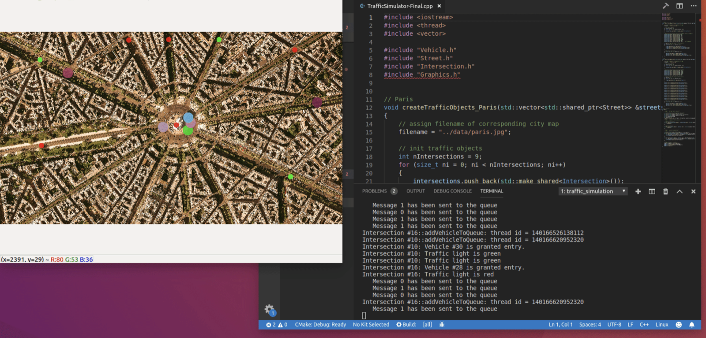
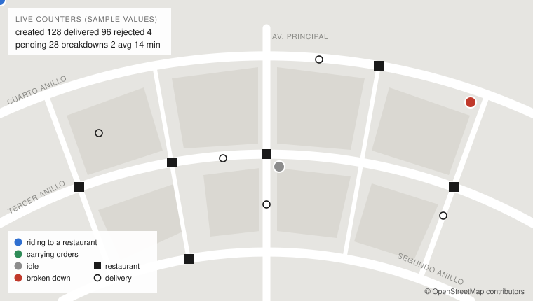

# Final Project — Equipetrol Delivery: a Concurrent Dispatch Simulation

## 1. The scenario

A delivery company operates in **Zona Equipetrol, Santa Cruz de la Sierra**, in the area
between the **Segundo Anillo** and the **Cuarto Anillo**. Restaurants in the zone receive
orders all day. A fleet of **motorcycle couriers** picks the orders up and carries them to
customers' doors. A **dispatcher** decides which courier takes which order.

Everything happens at once: orders keep arriving while couriers are riding, restaurants are
cooking, the dispatcher is deciding, and the map on screen keeps refreshing. Some things are
scarce and must be shared: a restaurant can only hand over food to a limited number of couriers
at a time, a courier's bag only holds a few orders, and there is only one order book.

You will build this system as a **concurrent C++17 program** that simulates the operation in
accelerated time and draws it live over a real map of the zone. The goal is not only that it
works, but that it uses concurrency to **serve more orders, faster, without ever losing,
duplicating or corrupting one**.

## 2. What it should look like



In your project **every motorcycle is a dot, and the dots move**: a courier is drawn at its
current position on the street it is riding, and that position advances continuously as the
courier rides, frame after frame. A dot that jumps from intersection to intersection, or that
stands still while the event log says the courier is riding, is a defect. Only idle and
broken-down couriers stand still.



*Illustration of what is expected, not a real map and not to scale. Your window shows the real
OpenStreetMap image of Equipetrol. The colours, shapes and layout are yours to choose.*

## 3. The map

You must produce the map yourself from **OpenStreetMap** data.

- The background image must show Zona Equipetrol **explicitly from the Segundo Anillo to the
  Cuarto Anillo**. The Segundo, Tercer and Cuarto Anillo and Avenida San Martín must all be
  visible and recognizable in the image.
- The image is used as shown in section 2: it is the
  background of the simulation window, and restaurants, customers and motorcycles are drawn on
  top of it at their real positions.
- You must record the **geographic bounding box** of your image (north, south, west, east) so
  that any latitude/longitude inside the zone maps to the correct pixel.
- You must model the **street network** of the zone as intersections connected by street
  segments, taken from the real map. Minimum size: **25 intersections**, **40 street
  segments** and **6 restaurants**, spread over the whole zone (not clustered around one ring).
  One-way streets, where you model them, must be respected.
- Couriers move **only along your street segments**. A motorcycle drawn crossing a block of
  houses is a defect.
- OpenStreetMap data is published under the ODbL. The attribution
  **"© OpenStreetMap contributors"** must be visible in the simulation window and present in
  your README. A map from any other provider is not accepted.

## 4. Rules of the simulated world

### Orders
- Orders are created continuously during the whole run, at random intervals, by the simulation
  itself. Orders also arrive in **bursts**: up to `orders.burstMax` orders may be created at the
  same instant, for different restaurants or for the same one, and the system must take them all
  in. Each order has a unique id, a restaurant, a delivery location on the street network,
  and a creation time.
- An order goes through these states, in this order, and never backwards:
  `created` → `assigned` → `pickedUp` → `delivered`.
  Two other endings exist: `rejected` (it can never be served) and `pending` (the simulation
  ended before it was finished).
- **Every order ends in exactly one final state.** An order is never lost, never delivered
  twice, and never carried by two couriers at the same time.
- An order needs preparation time at its restaurant before it can be picked up.
- If the order book already holds the configured maximum of waiting orders, new orders are
  rejected with reason `queueFull`.
- If the delivery location cannot be reached through the street network, the order is rejected
  with reason `unreachable`.
- If no courier accepts an order within the configured time, it is rejected with reason
  `noCourier`.

### Couriers
- Every courier acts **independently and simultaneously** with all the others for the whole run.
- A courier carries at most `bagCapacity` orders at any instant.
- A courier with nothing to do **waits without consuming CPU** until there is work or the
  simulation ends.
- A courier may suffer a **breakdown** at a random moment. The orders in its bag that were not
  yet delivered must be handed over to another courier. The handover is **all-or-nothing**:
  no observer may ever see an order in both bags or in neither. Two breakdowns happening at
  the same moment must not block the system.

### Restaurants
- Each restaurant has `pickupSlots` hand-over positions. At no instant may more couriers be
  collecting food there than it has slots. The others queue and are served in arrival order.

### Dispatcher
- For each new order, the dispatcher compares the candidate couriers by their **estimated time
  to deliver** and chooses the best one.
- Working out the estimates for one order **must not stop the rest of the system**: couriers
  keep riding, orders keep arriving, and the window keeps refreshing while estimates are being
  computed. The estimates of the different candidates must be computed **at the same time**, not
  one after another.
- The dispatcher waits for estimates no longer than `quoteTimeoutMs`. Estimates that arrive late
  are ignored. A failure while computing one estimate must reach the dispatcher as an error and
  must not take the program down.

### Time
- The simulation runs in accelerated time, controlled by `timeScale`. Riding, cooking and
  hand-over take simulated time.
- Pausing a thread is accepted **only** to represent simulated time passing or to pace the
  frame rate of the window. Pausing as a way to "wait for another thread to be ready" is a
  defect, and so is any loop that spins while checking a condition.

## 5. Input

The program receives the path to a JSON configuration file as its **first command-line
argument**. One optional flag may follow it:

| Flag | Meaning |
|------|---------|
| `--log <path>` | Write the event log to this file instead of `events.log`. |

```sh
delivery_sim config/equipetrol.json
delivery_sim config/equipetrol.json --log run1.log
```

There is no mode without a window: the simulation is always shown.

The configuration file is one JSON object with these properties. Reviewers will run your
program with **their own** configuration files that follow this format.

| Property | Type | Meaning |
|----------|------|---------|
| `map.image` | string | Path to the background image, relative to the configuration file. |
| `map.attribution` | string | Attribution text shown in the window. |
| `map.bounds` | object | `north`, `south`, `west`, `east` in decimal degrees. |
| `nodes` | array | Intersections: `id` (string), `lat`, `lon` (numbers). At least one. |
| `streets` | array | Segments: `id`, `from`, `to` (node ids), `oneWay` (boolean). |
| `restaurants` | array | `id`, `name`, `node` (node id), `pickupSlots` (integer ≥ 1), `prepTimeMs` (array `[min, max]`). |
| `fleet.couriers` | integer ≥ 1 | Number of motorcycles. |
| `fleet.bagCapacity` | integer ≥ 1 | Maximum orders carried at once. |
| `fleet.speedKmh` | number | Riding speed. |
| `fleet.startNode` | string | Node where all couriers begin. |
| `orders.meanIntervalMs` | integer | Mean simulated time between two new orders. |
| `orders.burstMax` | integer ≥ 1 | Largest number of orders that may be created at the same instant. |
| `orders.maxPending` | integer | Size limit of the order book. |
| `orders.seed` | integer | Seed for every random decision. |
| `dispatch.quoteTimeoutMs` | integer | Longest real time the dispatcher waits for estimates. |
| `dispatch.acceptTimeoutMs` | integer | Longest simulated time an order may wait for a courier. |
| `incidents.breakdownProbability` | number 0–1 | Chance that a courier breaks down during one trip. |
| `simulation.durationS` | integer | Simulated seconds to run. `0` means run until a signal arrives. |
| `simulation.timeScale` | number | Simulated seconds per real second. |

Example of the shape of the file (the values are illustrative, not real coordinates):

```json
{
  "map": {
    "image": "../data/equipetrol.png",
    "attribution": "© OpenStreetMap contributors",
    "bounds": { "north": 0.0, "south": 0.0, "west": 0.0, "east": 0.0 }
  },
  "nodes": [
    { "id": "n0", "lat": 0.0, "lon": 0.0 }
  ],
  "streets": [
    { "id": "s0", "from": "n0", "to": "n1", "oneWay": false }
  ],
  "restaurants": [
    { "id": "r0", "name": "Example", "node": "n0", "pickupSlots": 1, "prepTimeMs": [60000, 240000] }
  ],
  "fleet": { "couriers": 8, "bagCapacity": 3, "speedKmh": 30, "startNode": "n0" },
  "orders": { "meanIntervalMs": 20000, "burstMax": 12, "maxPending": 50, "seed": 42 },
  "dispatch": { "quoteTimeoutMs": 200, "acceptTimeoutMs": 600000 },
  "incidents": { "breakdownProbability": 0.02 },
  "simulation": { "durationS": 3600, "timeScale": 60 }
}
```

### Invalid input
If the argument is missing, the file cannot be read, the JSON is malformed, a required property
is absent, or a street or restaurant refers to a node that does not exist, the program must
print a human-readable message to `stderr` and exit with a **non-zero** status **without
starting any simulation**.

## 6. Output

### 6.1 Start line
As soon as the simulation is ready and running, the program must print exactly this line to
`stdout`, so that tests do not start observing too early:

```
Simulation has started...
```

### 6.2 Event log
Every state change is recorded in the event log as **one JSON object per line**. Every line
must be a complete, valid JSON object on its own; two events must never be mixed inside one line.

| Property | Type | Present in |
|----------|------|-----------|
| `t` | integer, simulated milliseconds since start | every event |
| `event` | string, one of the names below | every event |
| `order` | string | every order event |
| `courier` | string | events that involve a courier |
| `restaurant` | string | `orderCreated`, `pickupStarted`, `orderPickedUp` |
| `from`, `to` | strings, courier ids | `orderReassigned` |
| `reason` | `queueFull` \| `unreachable` \| `noCourier` | `orderRejected` |

Event names: `orderCreated`, `orderAssigned`, `pickupStarted`, `orderPickedUp`,
`orderDelivered`, `orderRejected`, `courierBreakdown`, `orderReassigned`,
`simulationStopping`.

Example lines:

```json
{"t": 15230, "event": "orderCreated", "order": "o17", "restaurant": "r3"}
{"t": 15410, "event": "orderAssigned", "order": "o17", "courier": "c5"}
{"t": 322900, "event": "orderRejected", "order": "o21", "reason": "unreachable"}
```

For any single order, the values of `t` must never decrease along its events.

### 6.3 Final summary
When the simulation ends, the program prints one JSON object to `stdout` as its **last line**:

```json
{"created": 0, "delivered": 0, "rejected": 0, "pending": 0, "reassigned": 0, "breakdowns": 0, "avgDeliveryMs": 0, "maxDeliveryMs": 0, "deliveredPerCourier": {"c0": 0}}
```

These numbers must be **exact**, and they must agree with the event log:
`created = delivered + rejected + pending`, the values of `deliveredPerCourier` add up to
`delivered`, and every count equals the number of matching lines in the log.

### 6.4 The window
The program always opens a window, as shown in section 2. It shows the map image with, at
their true positions: every restaurant, every courier as a **moving dot** (distinguishable as
idle, riding to a restaurant, carrying orders, or broken down), the delivery location of every
active order, a live panel with the counters of section 6.3, and the map attribution. Dots
advance smoothly along the streets. The picture must stay fluid while the system is under
load, and what it shows must never contradict the event log.

## 7. Stopping

The simulation ends when `simulation.durationS` simulated seconds have passed, or when the
process receives **`SIGINT`** or **`SIGTERM`**, whichever comes first. In both cases the program
must:

1. stop creating orders and record `simulationStopping`;
2. bring **every** thread of execution to an orderly end — none abandoned, none killed by the
   process exiting;
3. report every unfinished order as `pending`;
4. print the final summary and exit with status `0`, within **5 real seconds** of the signal.

## 8. Build

The project is built with **CMake and make**, using exactly the commands below.
**Do not change the name of the main target: `delivery_sim`.**

Dependencies: cmake ≥ 3.11, make ≥ 4.1 (Linux, Mac) or 3.81 (Windows), gcc/g++ ≥ 7 or an
equivalent clang, OpenCV ≥ 4.1, and one JSON library of your choice that your CMake project
provides or finds by itself.

1. Clone your repository.
2. Make a build directory in the top-level directory: `mkdir build && cd build`
3. Compile: `cmake .. && make`
4. Run it: `./delivery_sim ../config/equipetrol.json`

The build must succeed with these commands and nothing else, without warnings under
`-Wall -Wextra`. Your CMake project must also offer the option `ENABLE_TSAN`; configuring with
`cmake -DENABLE_TSAN=ON ..` must produce the same target instrumented with ThreadSanitizer.

### Allowed and forbidden
- **Allowed:** the C++17 standard library, OpenCV for the window only, one JSON library for
  reading and writing JSON only.
- **Forbidden:** any other library or language feature that provides threading, task
  scheduling, thread pools, concurrent containers or synchronization (OpenMP, TBB, Boost.Asio,
  Boost.Thread, Qt, platform threads used directly, and similar). The concurrency in this
  project is built from what the course taught.

## 9. Task list

- **Task DP.1 — City model.** Obtain the OpenStreetMap image of the zone, record its bounds,
  model the street network and the restaurants, and write `config/equipetrol.json`. Load any
  valid configuration at start-up and refuse any invalid one as described in section 5.
- **Task DP.2 — Orders.** Generate orders for the whole run according to the configuration,
  reproducibly for a given seed, and keep the order book within its limit.
- **Task DP.3 — Fleet.** Run every courier as an independent, simultaneous actor that rides the
  street network, collects, delivers, and rests without consuming CPU when it has nothing to do.
- **Task DP.4 — Dispatch.** Assign each order to the best courier using estimates that are
  computed simultaneously and off the critical path, honouring both time limits and surviving
  errors in individual estimates.
- **Task DP.5 — Scarce resources.** Enforce restaurant pickup slots, bag capacity and the order
  book limit at every instant, under any interleaving.
- **Task DP.6 — Incidents.** Implement breakdowns and the all-or-nothing handover of orders
  between two couriers, including simultaneous breakdowns.
- **Task DP.7 — Observability.** Produce the start line, the event log and the final summary
  exactly as specified in section 6, consistent with each other in every run.
- **Task DP.8 — Visualization.** Draw the live simulation over the map as specified in
  sections 2 and 6.4, with every motorcycle as a dot that moves.
- **Task DP.9 — Shutdown.** End cleanly on timeout and on `SIGINT` / `SIGTERM` as specified in
  section 7.
- **Task DP.10 — Experiments.** Experiment with your system. Decide for yourself what is worth
  varying and what is worth measuring, run the experiments, and present the results in a
  **comparison table**. For every experiment, state what you changed, what you kept equal, what
  you measured, and what you conclude from the numbers. At least one experiment must lead to a
  change in your design, reported with its numbers before and after.
- **Task DP.11 — Analysis with tools.** Do not rely on the program "looking right". Examine it
  with dynamic analysis tools that look for **memory leaks, memory errors and data races**, such
  as **Valgrind** (Memcheck, Helgrind, DRD) or the **Clang/LLVM sanitizers** (AddressSanitizer,
  LeakSanitizer, ThreadSanitizer). At least one tool must target memory and at least one must
  target races, and each must observe a complete run of `config/equipetrol.json` that includes
  bursts of orders, breakdowns and a shutdown by signal. For every tool, your final report
  states the tool and its version, the exact command used, what it reported, what you changed
  in response, and the result of running it again. Anything a tool still reports in your final
  version must be listed and explained; an unexplained report counts as a defect.
- **Task DP.12 — Final report.** In your `README.md`, deliver: build and run instructions;
  a **program schematic**: a diagram showing every thread
  of execution, what each one loops over, and every channel through which two of them
  communicate or wait for each other; the **concept map** of section 10; the experiments
  of DP.10; and the **tool analysis results** of DP.11.

## 10. Concept map (mandatory)

Your README must contain the first two columns of this table, completed. For every row, name the
file and the place in your code where the concept is used, and explain **in one or two sentences
why that concept is the right one at that place** and what would go wrong without it. A concept
that appears in the code only to fill the row, without a real job to do, does not count.

The third column is **for self-study**. It lists topics that extend each folder beyond what the
course covered. They are not required and not graded. Topics marked *C++20* are for reading
only, because this project is built as C++17.

| Course folder | Concept that must be present and justified | Self-study: where the folder continues |
|---------------|--------------------------------------------|----------------------------------------|
| `01` | Explicit thread creation and a deliberate fate (joined, never abandoned) for every thread | `std::jthread` and cooperative cancellation with `std::stop_token` *(C++20)*; what the operating system scheduler does with your threads |
| `01` | A decision that depends on the hardware's available parallelism | Amdahl's and Gustafson's laws; oversubscription; context-switch cost; thread affinity |
| `02` | Data handed to a thread by value, by reference, and by move — each where it is the right choice | Perfect forwarding and `std::forward`; decay-copy; `std::reference_wrapper` in depth |
| `02` | Orders travelling through the system by move semantics, existing in one place at a time | Lambda init-capture for move-only types; value categories (lvalue, xvalue, prvalue); copy elision rules |
| `03` | Member functions of shared objects running on threads; containers of threads | Thread pools and work queues; work stealing; `std::invoke` and callable wrappers |
| `03` | Shared ownership that guarantees lifetime; no owning raw pointers anywhere | `std::weak_ptr` and ownership cycles; `std::enable_shared_from_this`; the cost of atomic reference counting |
| `04` | Tasks that return a result through a future, with a stated launch policy | `std::packaged_task`; executors and schedulers; structured concurrency |
| `04` | A promise/future pair used as a one-shot channel between two threads | `std::shared_future`; continuations and `when_all` / `when_any` style composition; coroutines *(C++20)* |
| `04` | A wait with a time limit, and an exception that crosses from one thread to another | `std::exception_ptr` in depth; timeouts and clocks (`steady_clock` versus `system_clock`); cancellation of abandoned work |
| `05` | A written argument, per shared object, of why no data race is possible on it | The C++ memory model and *happens-before*; ThreadSanitizer and Helgrind; Lamport's and vector clocks |
| `05` | A type that is safe to copy or move because its special member functions are correct | `std::atomic`, compare-and-swap and memory orderings; false sharing and cache lines; the ABA problem and lock-free structures |
| `06` | Mutual exclusion exclusively through scope-bound locks; short critical sections | `std::shared_mutex` and readers–writer locking; `std::timed_mutex` and `try_lock`; lock contention and how to measure it |
| `06` | One operation that needs two locks at once, and the reason it cannot deadlock | Lock hierarchies; livelock, starvation and fairness; priority inversion; the dining philosophers |
| `07` | Monitor objects: shared data that cannot be reached without its lock | Hoare versus Mesa monitor semantics; the actor model; channels as in Go and Rust |
| `07` | Threads that block until a condition holds and are woken by another thread, robust to wake-ups that carry no news and to a final wake-up for shutdown | Bounded buffers and back-pressure; `std::counting_semaphore`, `std::latch`, `std::barrier` *(C++20)*; `std::condition_variable_any`; the sleeping barber and readers–writers problems |

Recommended reading for the third column: Anthony Williams, *C++ Concurrency in Action* (2nd
edition); the concurrency sections of the *C++ Core Guidelines* (CP rules); and the thread
support pages of cppreference.

## 11. How your project will be tested

1. It is built with the commands of section 8 on a clean machine, then again with
   `-DENABLE_TSAN=ON`.
2. It is run with the reviewers' own configuration files, with the window open: a small one, a
   large one (hundreds of intersections, 64 couriers, a very high order rate), one where large
   bursts of orders are created at the same instant, one with a single pickup slot everywhere,
   one with a bag capacity of 1, one with a breakdown probability of 1, one with unreachable
   delivery locations, and several invalid ones.
3. Observation begins only after `Simulation has started...` appears.
4. The event log and the final summary are checked by a program against **every rule of
   sections 4, 6 and 7**: one final state per order, no order in two bags, capacities never
   exceeded, arrival-order service at restaurants, time never running backwards for an order,
   every line valid JSON, exact counters, and summary equal to log.
5. Each scenario is run **many times**, under ThreadSanitizer and under a memory checker. A
   single reported data race, a single memory error or leak, a single lost or duplicated order,
   or a single hang in any run fails the corresponding criterion: defects that appear "only
   sometimes" are defects. The reviewers' tool output is compared with the results in your
   final report.
6. `SIGINT` and `SIGTERM` are sent at random moments, including immediately after the start
   line and during a burst of breakdowns. Exit status, the 5-second limit, the summary and the
   absence of abandoned threads are checked.
7. CPU usage is measured during a run configured with couriers but almost no orders. Apart from
   the cost of drawing the window, a process that burns CPU while it has nothing to do fails DP.3.
8. The window is watched by a person during these runs and reviewed against sections 2, 3 and
   6.4: the dots must move, along the streets, in agreement with the log.
9. The README is reviewed by a person. You may be asked to explain any line of your concept map
   and schematic orally.

## 12. Rubric

| | Criteria | Submission requirements | Points |
|---|----------|-------------------------|:-----:|
| **DP.0** | The project builds and runs | Builds with `mkdir build && cd build`, `cmake .. && make` and nothing else; target is `delivery_sim`; no warnings with `-Wall -Wextra`; `ENABLE_TSAN` option works; only allowed libraries are used. **A project that does not build is not reviewed further.** | gate |
| **DP.1** | The city is real | OpenStreetMap image covering Equipetrol from the Segundo to the Cuarto Anillo, with attribution; bounds recorded; street network and restaurants meet the minimum sizes and are spread over the zone; positions on screen match the map. | 6 |
| | Configuration is honoured | Any valid file in the format of section 5 runs; every invalid case exits non-zero with a message and without simulating. | 4 |
| **DP.2** | Orders are generated correctly | Continuous, random, reproducible for a seed; the order book limit holds; `queueFull` and `unreachable` rejections are correct. | 6 |
| **DP.3** | Couriers are truly concurrent | All couriers progress simultaneously; movement follows streets and one-way rules; bag capacity is never exceeded. | 8 |
| | Idle costs nothing | Near-zero CPU usage when there is no work; no spinning loops; no pause used as coordination. | 6 |
| **DP.4** | Dispatch is concurrent and robust | Estimates for an order are computed simultaneously and never stall the rest of the system; both time limits are honoured; a failing estimate is reported as an error and survived; `noCourier` is correct. | 8 |
| **DP.5** | Scarce resources are respected | Pickup slots and arrival-order service hold at every instant in every run. | 8 |
| **DP.6** | Incidents are atomic | Handover is all-or-nothing; simultaneous breakdowns never hang the system. | 8 |
| **DP.7** | The program tells the truth | Start line, event log and summary match section 6 exactly and agree with each other in every run; no interleaved lines; counters exact. | 8 |
| | No data races | ThreadSanitizer reports nothing in any scenario, in any run. | 8 |
| **DP.8** | The simulation can be watched | The window always opens and meets sections 2 and 6.4: every motorcycle is a dot that moves smoothly along the streets; the picture stays fluid under load and never contradicts the log. | 6 |
| **DP.9** | The program stops cleanly | Timeout, `SIGINT` and `SIGTERM` all follow section 7: every thread ended, `pending` reported, summary printed, status `0`, within 5 seconds. | 6 |
| **DP.10** | The system was experimented with | Experiments are the student's own, fair (one thing varied, the rest kept equal) and reproducible; results are presented in a comparison table; conclusions follow from the numbers; one experiment led to a design change with before/after numbers. | 6 |
| **DP.11** | The program was analysed with tools | At least one memory tool and one race tool (such as Valgrind or the Clang/LLVM sanitizers) were run over a complete run with bursts, breakdowns and a signal shutdown; the final report gives tool, version, command, findings, fixes and the re-run; the final version is free of leaks and memory errors, or every remaining report is listed and correctly explained; the results match what the reviewers obtain. | 6 |
| **DP.12** | The design is explained | The final report's schematic shows every thread and every channel and matches the code; the concept map of section 10 is complete, points to real code, and every justification is correct. | 6 |
| | | **Total** | **100** |

To pass, a submission must clear the DP.0 gate, score at least **70 points**, and obtain full
marks in **"No data races"**.

## 13. What to submit

A repository containing:

- the source code and `CMakeLists.txt`;
- `config/equipetrol.json` and the map image it refers to, under `data/`;
- `README.md`, your final report, with everything required by DP.12, the OpenStreetMap
  attribution, and the list of dependencies with the versions you used;
- the raw data of the experiments of DP.10 (configuration files, event logs and summaries of
  every run that appears in your comparison table);
- the complete, unedited output of every tool run reported under DP.11, as text files.

Work individually. Check every row of the rubric before you submit.
